University: [ITMO University](https://itmo.ru/ru/)
Faculty: [FICT](https://fict.itmo.ru)
Course: [Cloud platforms as the basis of technology entrepreneurship](https://github.com/itmo-ict-faculty/cloud-platforms-as-the-basis-of-technology-entrepreneurship)
Year: 2026/2027
Group: U4125
Author: Moiseenko Daria Evgenievna
Lab: Lab1
Date of create: 02.11.2026
Date of finished: 02.11.2026

# Лабораторная работа №1 «Обзор Google Cloud и исследование основных сервисов»

## Цель работы

Ознакомиться с основными возможностями облачной платформы Google Cloud: сервисными аккаунтами и ролями IAM, виртуальными машинами Compute Engine и объектным хранилищем Cloud Storage.

## Исходные данные

| Параметр | Значение |
|---|---|
| Проект GCP | `cloud-platforms-as-the-basis` |
| Сервисный аккаунт | `dmoiseenko-sa-lab1@cloud-platforms-as-the-basis.iam.gserviceaccount.com` |
| Виртуальная машина | `dmoiseenko-vm-lab1`, `e2-micro`, Spot, зона `us-central1-a`, Debian 13 |
| Бакет с файлами | `gs://lab1-bucket-itmo` |

## Ход работы

### 1. Создание сервисного аккаунта с ролью Storage Admin

В разделе **IAM & Admin → Service Accounts** создан сервисный аккаунт `dmoiseenko-sa-lab1`. Имя составлено по шаблону: первая буква имени и фамилия + `-sa-lab1`.

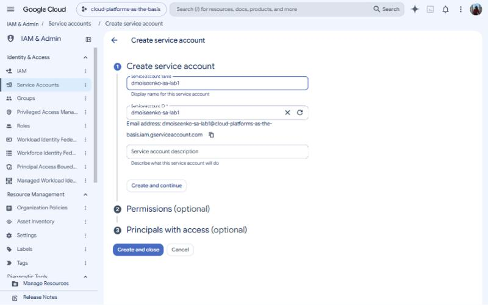

На втором шаге мастера аккаунту выдана роль **Storage Admin** (`roles/storage.admin`). Эта роль даёт полный доступ к бакетам и объектам Cloud Storage.

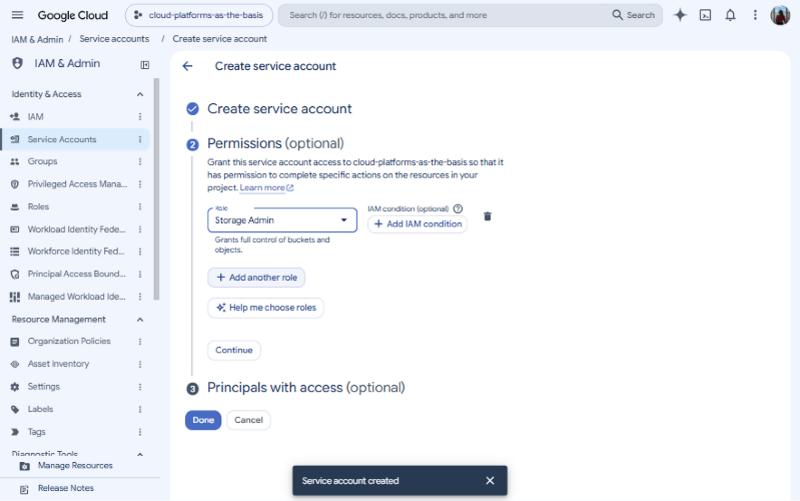

Роль появилась на странице IAM проекта:

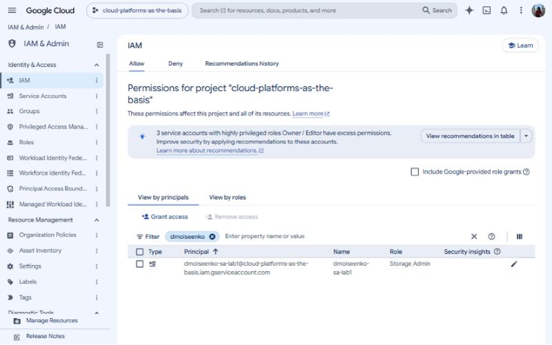

### 2. Создание виртуальной машины e2-micro в режиме Spot

В **Compute Engine → VM instances → Create instance** заданы параметры:

* имя `dmoiseenko-vm-lab1`;
* регион `us-central1`, тип машины `e2-micro` (0.25–2 vCPU, 1 GB RAM);
* модель предоставления (provisioning model) **Spot**. Такая ВМ стоит заметно дешевле, но Google может остановить её в любой момент. При вытеснении выбрано действие Stop.

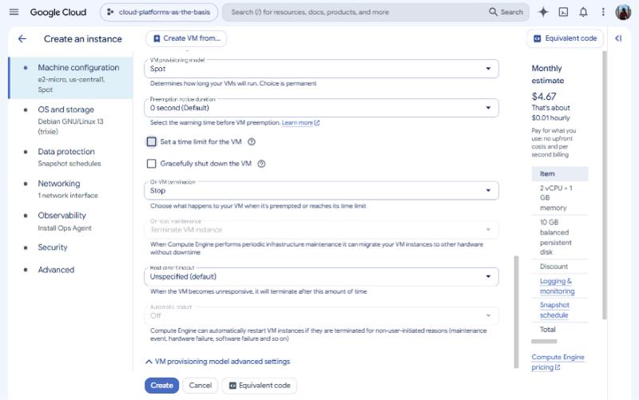

В разделе **Security** машине назначен сервисный аккаунт `dmoiseenko-sa-lab1`, а в Access scopes выбрано *Allow full access to all Cloud APIs*. При таком выборе права ВМ определяются только ролями IAM сервисного аккаунта, а не урезаются scope'ами.

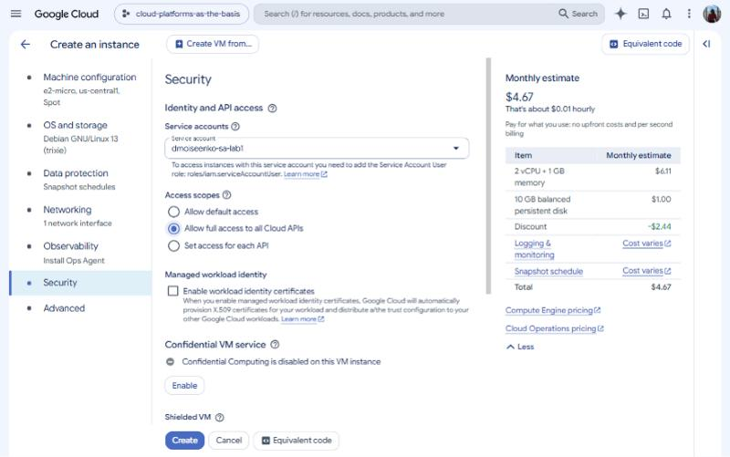

В разделе **Advanced → Automation** задан стартовый скрипт (startup script). Он выполняется от root при каждой загрузке ВМ и пишет вывод в Serial port 1:

```bash
#!/bin/bash
echo "===== LAB1 RUN $(date -u) ====="
mkdir -p /home/lab1 && cd /home/lab1
rm -f /home/lab1/*
echo "--- active account (service account) ---"
gcloud config list account --format='value(core.account)'
echo "--- gcloud storage ls gs://lab1-bucket-itmo ---"
gcloud storage ls gs://lab1-bucket-itmo/
echo "--- copy 3 files ---"
for f in $(gcloud storage ls gs://lab1-bucket-itmo/ | grep -v '/$' | head -3); do
  gcloud storage cp "$f" /home/lab1/
done
echo "--- ls -lah /home/lab1 ---"
ls -lah /home/lab1
echo "===== LAB1 END ====="
```

> **Почему стартовый скрипт, а не SSH.** В аудиторном варианте команды набираются в SSH-сессии на ВМ. Здесь используется тот же `gcloud` на той же ВМ от имени того же сервисного аккаунта, но команды запускаются автоматически при загрузке. Чтобы повторить прогон после смены роли, достаточно сделать **Reset** ВМ. Вывод виден в **VM → Logs → Serial port 1 (console)**.

ВМ создана и запущена:

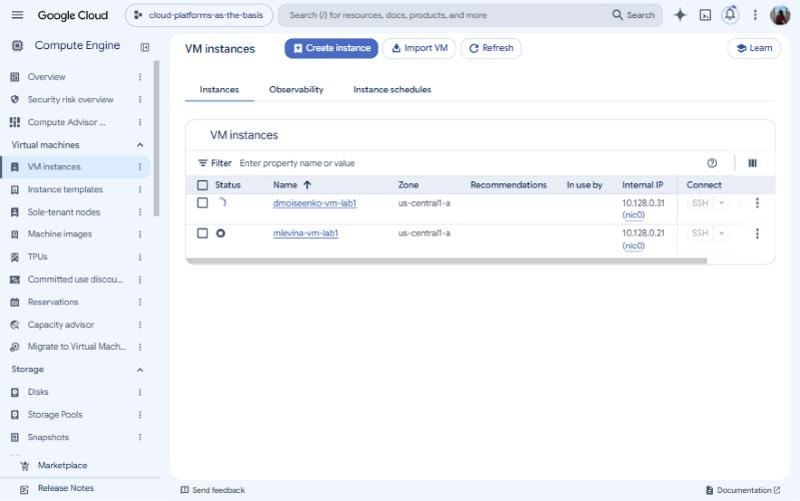

### 3. Копирование 3 файлов из бакета `lab1-bucket-itmo` (роль Storage Admin)

Из лога Serial port 1 видно, что команды выполнены от имени сервисного аккаунта `dmoiseenko-sa-lab1`. `gcloud storage ls` показал в бакете три файла: `pic1.jpg`, `pic2.jpg`, `pic3.jpeg`.

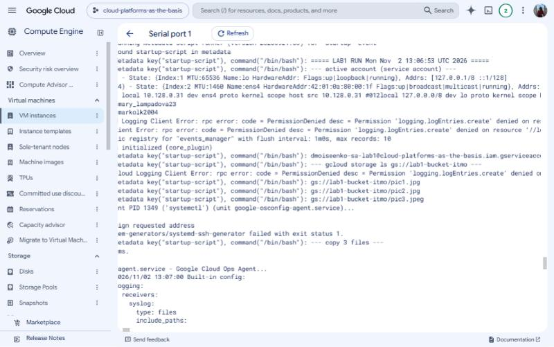

Все три файла скопированы в `/home/lab1`, и `ls -lah` подтверждает, что они на диске ВМ:

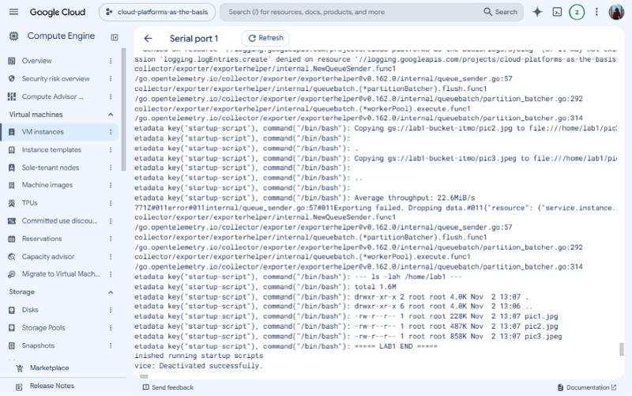

```text
--- ls -lah /home/lab1 ---
total 1.6M
drwxr-xr-x 2 root root 4.0K Nov  2 13:07 .
drwxr-xr-x 6 root root 4.0K Nov  2 13:06 ..
-rw-r--r-- 1 root root 228K Nov  2 13:07 pic1.jpg
-rw-r--r-- 1 root root 487K Nov  2 13:07 pic2.jpg
-rw-r--r-- 1 root root 858K Nov  2 13:07 pic3.jpeg
```

Полный лог: [logs/run1_storage_admin.log](logs/run1_storage_admin.log)

### 4. Замена роли на Compute Viewer и повторное копирование

На странице IAM роль сервисного аккаунта заменена: Storage Admin → **Compute Viewer** (`roles/compute.viewer`). Эта роль даёт только чтение ресурсов Compute Engine (ВМ, дисков, сетей) и никаких прав на Cloud Storage.

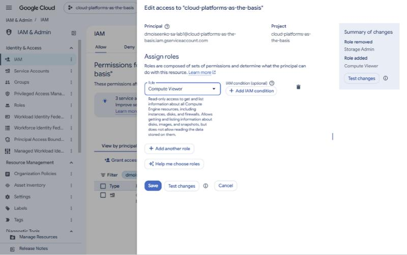
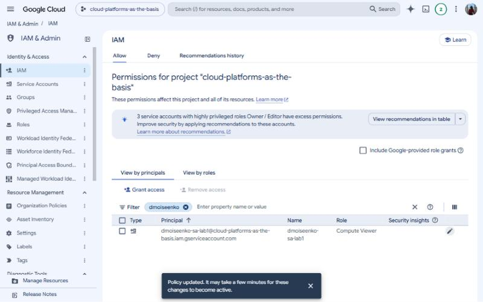

После применения политики ВМ перезапущена (Reset), и скрипт отработал ещё раз. Результат неожиданный: **файлы снова скопировались**.

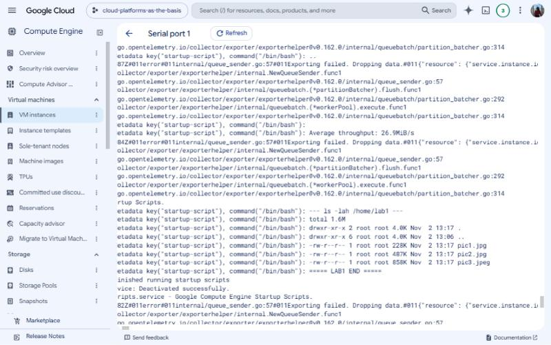

Лог: [logs/run2_compute_viewer.log](logs/run2_compute_viewer.log)

**Почему так произошло.** На вкладке *Permissions* бакета `lab1-bucket-itmo` видно, что ему выдана роль **Storage Object Viewer для `allUsers`**. Бакет публичный: читать его объекты может кто угодно в интернете, даже без авторизации. Поэтому для чтения файлов роль сервисного аккаунта не имеет значения.

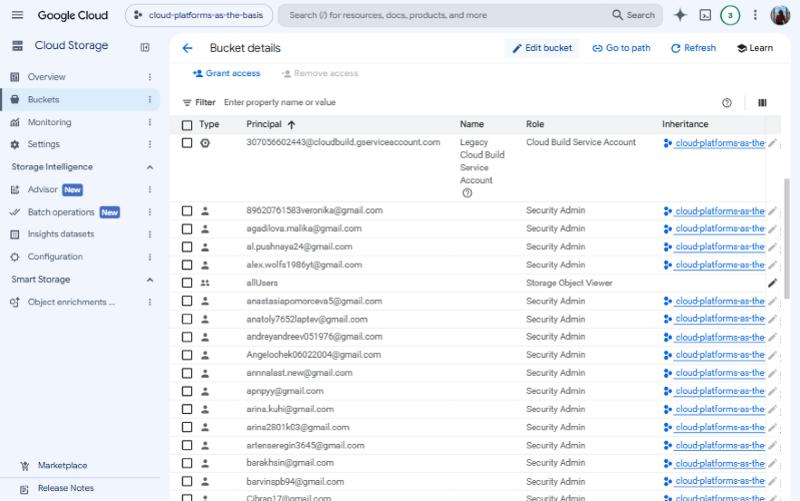

### 5. Дополнительная проверка: где роли действительно различаются

Чтобы разница ролей стала видна, в стартовый скрипт добавлены две операции, которые требуют конкретных прав:

* `gcloud storage ls --project=...` выводит список бакетов проекта, для этого нужно право `storage.buckets.list`;
* `gcloud compute instances list` выводит список ВМ, для этого нужно право `compute.instances.list`.

**Роль Compute Viewer** ([лог](logs/run3_compute_viewer_extended.log)):

```text
--- [2] list project buckets (needs storage.buckets.list) ---
ERROR: (gcloud.storage.ls) HTTPError 403: dmoiseenko-sa-lab1@... does not have
storage.buckets.list access to the Google Cloud project.
--- [3] list VMs (needs compute.instances.list) ---
NAME                ZONE           MACHINE_TYPE  PREEMPTIBLE  ...  STATUS
dmoiseenko-vm-lab1  us-central1-a  e2-micro      true         ...  RUNNING
```

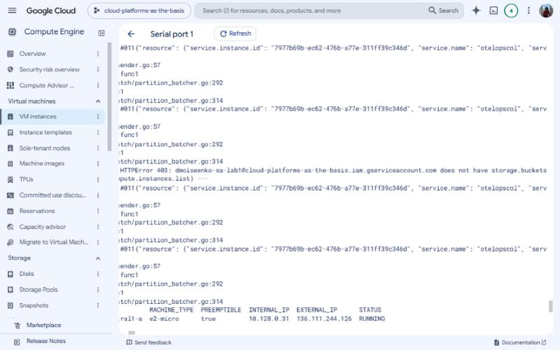
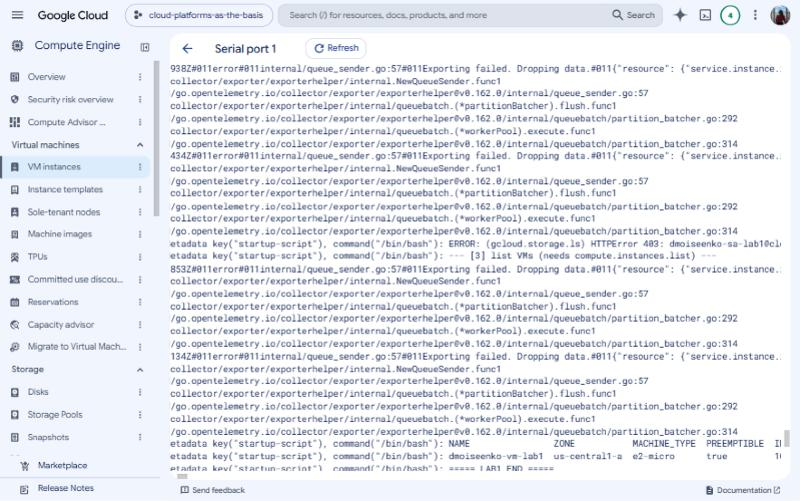

**Роль Storage Admin** ([лог](logs/run4_storage_admin_extended.log)). Для сравнения роль вернули обратно:

```text
--- [2] list project buckets (needs storage.buckets.list) ---
gs://lab1-bucket-itmo/
--- [3] list VMs (needs compute.instances.list) ---
WARNING: Some requests did not succeed.
 - Required 'compute.instances.list' permission for 'projects/cloud-platforms-as-the-basis'
```

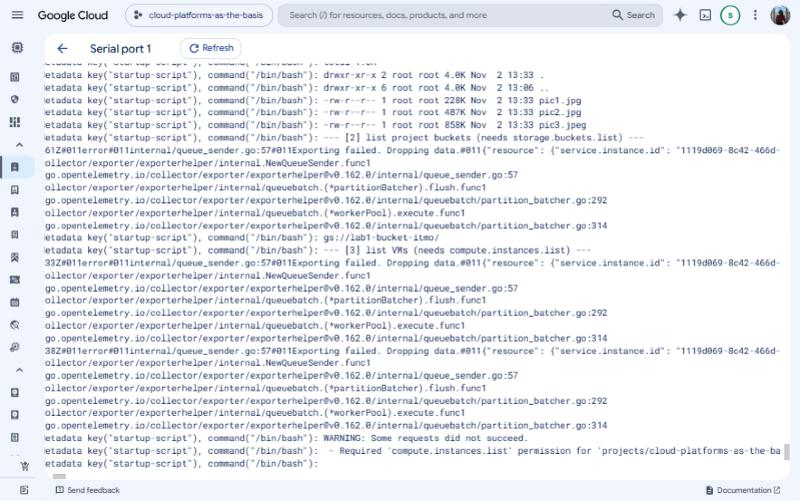

### 6. Удаление ресурсов

Удалено:

1. ВМ `dmoiseenko-vm-lab1` вместе с загрузочным диском;
2. привязка роли сервисного аккаунта в IAM проекта (Remove access);
3. сервисный аккаунт `dmoiseenko-sa-lab1`.

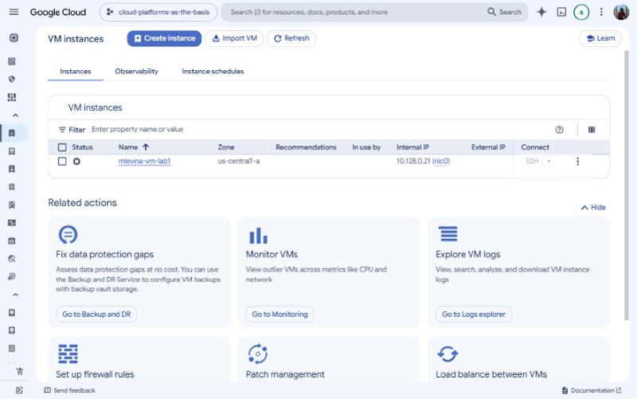
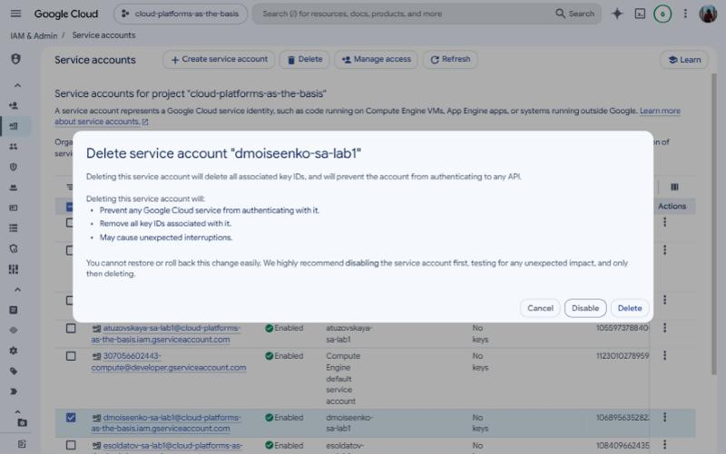

## Результаты

| Операция | Storage Admin | Compute Viewer |
|---|---|---|
| Чтение/копирование файлов из `lab1-bucket-itmo` | ✅ | ✅ (бакет публичный, `allUsers`) |
| Список бакетов проекта (`storage.buckets.list`) | ✅ | ❌ 403 |
| Список ВМ проекта (`compute.instances.list`) | ❌ | ✅ |

## Выводы

1. **Сервисный аккаунт** — это «учётная запись программы». ВМ получает его токен через сервер метаданных, поэтому `gcloud` на ВМ работает без логина и паролей. В облаке так и следует раздавать доступ приложениям: без ключей в коде.
2. **Права определяются ролями IAM** по принципу минимальных привилегий. Storage Admin управляет только Cloud Storage и не видит Compute Engine. Compute Viewer, наоборот, только читает ресурсы Compute Engine и не имеет доступа к хранилищу. Роли не наследуют друг друга, каждая покрывает свою область.
3. **Права ресурса суммируются с правами проекта.** Файлы скопировались и с ролью Compute Viewer, потому что сам бакет открыт для `allUsers`. Итоговый доступ равен объединению политики проекта и политики ресурса. Если бы бакет был приватным, копирование с Compute Viewer завершилось бы ошибкой 403, такой же, как при попытке получить список бакетов.
4. **Изменения IAM применяются не мгновенно.** Консоль предупреждает, что на это может уйти несколько минут. Это нужно учитывать при отладке прав.
5. **Spot e2-micro** — самый дешёвый способ получить ВМ для экспериментов (около $4.67 в месяц против $7.11 в стандартном режиме по оценке консоли). Подходит только для задач, которые переживут внезапную остановку.
