University: [ITMO University](https://itmo.ru/ru/)
Faculty: [FICT](https://fict.itmo.ru)
Course: [Cloud platforms as the basis of technology entrepreneurship](https://github.com/itmo-ict-faculty/cloud-platforms-as-the-basis-of-technology-entrepreneurship)
Year: 2026/2027
Group: U4125
Author: Moiseenko Daria Evgenievna
Lab: Lab2
Date of create: 02.11.2026
Date of finished: 02.11.2026

# Лабораторная работа №2 «Исследование Cloud Run»

## Цель работы

Ознакомиться с работой Cloud Run: развернуть контейнер, протестировать его, изучить логи и метрики, поменять конфигурацию, поработать с ревизиями и распределением трафика.

## Исходные данные

| Параметр | Значение |
|---|---|
| Проект GCP | `cloud-platforms-as-the-basis` |
| Сервис | `dmoiseenko-run-lab2`, регион `europe-west1` |
| Образ | `us-docker.pkg.dev/cloudrun/container/hello` (дефолтный сервис Hello) |
| URL | `https://dmoiseenko-run-lab2-307056602443.europe-west1.run.app` |

## Ход работы

### 1. Создание сервиса с минимальными ресурсами

**Cloud Run → Create service → Deploy one revision from an existing container image.** Кнопкой *Test with a sample container* подставлен образ `hello`.

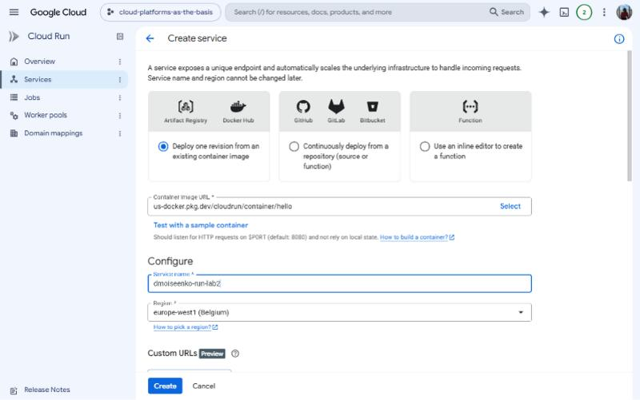

Настройки:

* **Authentication**: *Allow public access*, чтобы сервис открывался по ссылке без авторизации;
* **Billing**: *Request-based*, оплата только за время обработки запросов;
* **Autoscaling**: min instances = 0 (сервис «засыпает», когда запросов нет), max instances = 1;
* **Resources**: Memory **128 MiB** (минимум), CPU **1**.

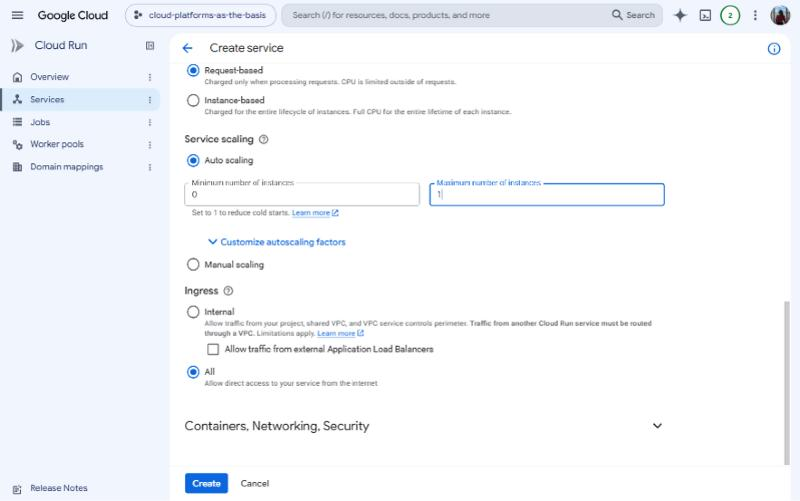
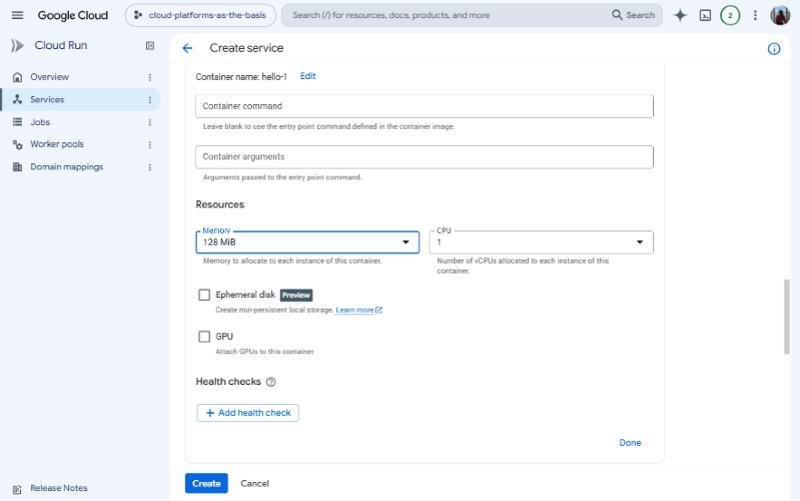

Сервис развёрнут, создана ревизия `dmoiseenko-run-lab2-00001-lcm`, на неё идёт 100% трафика:

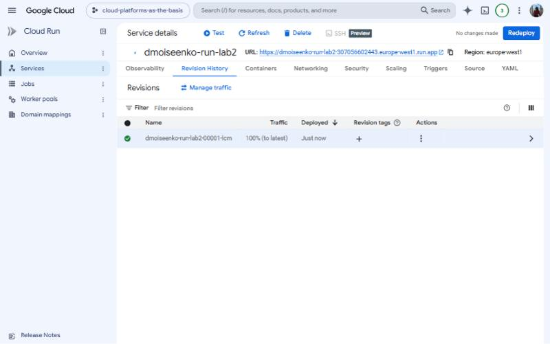

### 2. Тестирование по выданной ссылке

По URL сервиса открывается страница «It's running!» с именем ревизии, сервиса, региона и проекта:

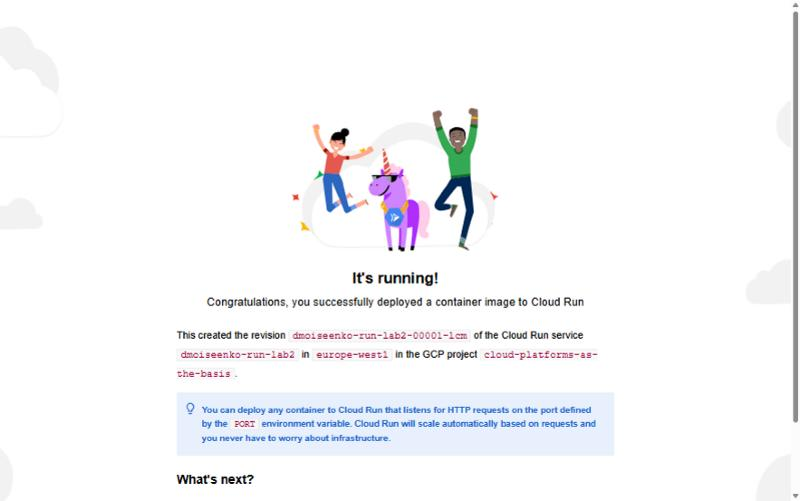

### 3. Логи и метрики

**Observability → Logs.** Каждый HTTP-запрос записывается отдельной строкой: время, метод `GET`, код ответа `200`, размер ответа (≈4.96 KiB), время обработки (1–3 мс), User-Agent и URL.

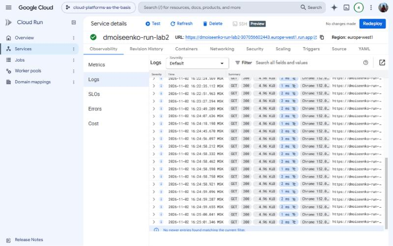

**Observability → Metrics** (за последние 30 минут):

* *Request count*: всплеск запросов в момент тестирования, все ответы 2xx;
* *Request latencies / End-to-end latency*: задержки порядка 5–20 мс;
* *Container instance count*: инстанс появляется при первом запросе (холодный старт) и переходит в idle после окончания нагрузки. При min instances = 0 Cloud Run затем сворачивает его до нуля;
* *Container CPU / Memory utilization*: CPU около 1–2%, память около 22% от 128 MiB. Минимальных ресурсов для hello-сервиса хватает с большим запасом.

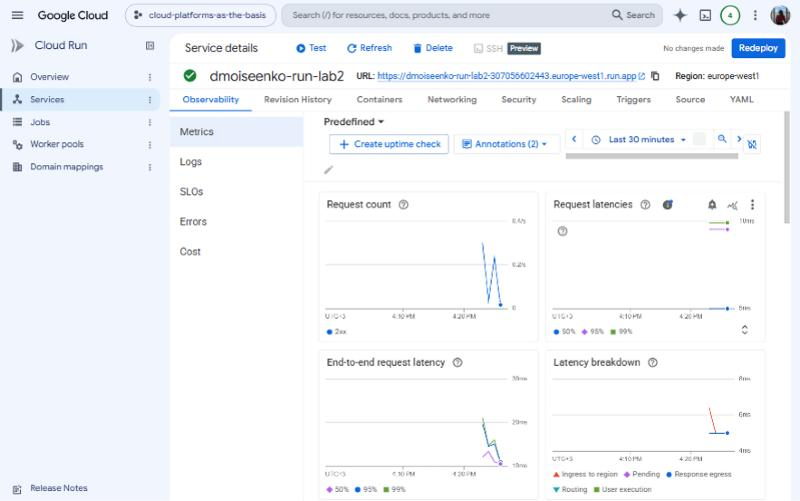
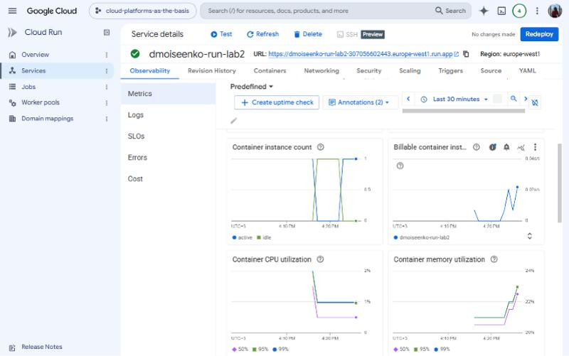

### 4. Смена порта на 8090

Во вкладке **Containers** параметр *Container port* изменён с 8080 на **8090**, затем выполнен *Deploy changes*. Консоль показывает diff изменений:

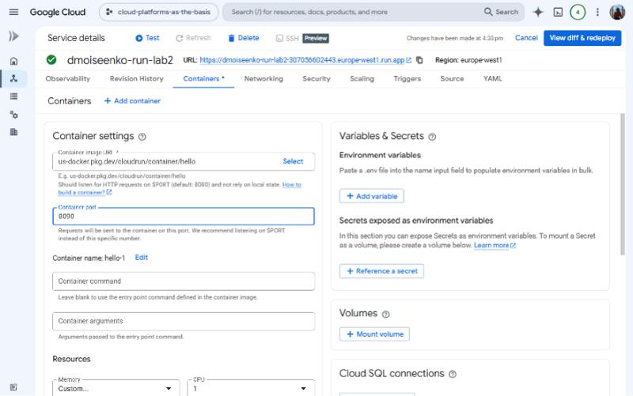

Создана новая ревизия `dmoiseenko-run-lab2-00002-68g`. Сервис **продолжил работать**:

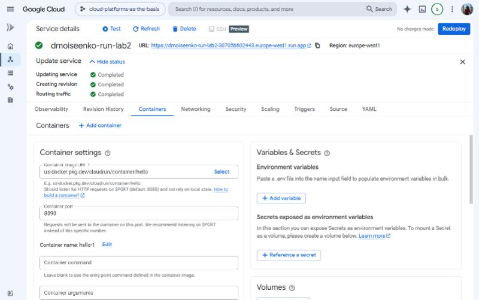
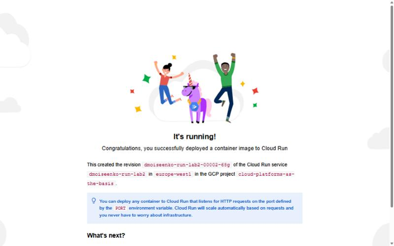

**Что произошло и почему.** Cloud Run передаёт контейнеру номер порта через переменную окружения `$PORT` и направляет трафик на этот порт. Образ `hello` слушает именно `$PORT`, а не жёстко заданный 8080, поэтому после смены настройки он сам начал слушать 8090. Если бы приложение было написано с фиксированным портом 8080, новая ревизия не прошла бы проверку запуска (startup probe), не стала бы «healthy», и Cloud Run оставил бы трафик на старой ревизии. Отсюда правило: в контейнере для Cloud Run порт нужно брать из `$PORT`.

### 5. Переключение трафика между ревизиями

У сервиса две ревизии: 00001 (порт 8080) и 00002 (порт 8090).

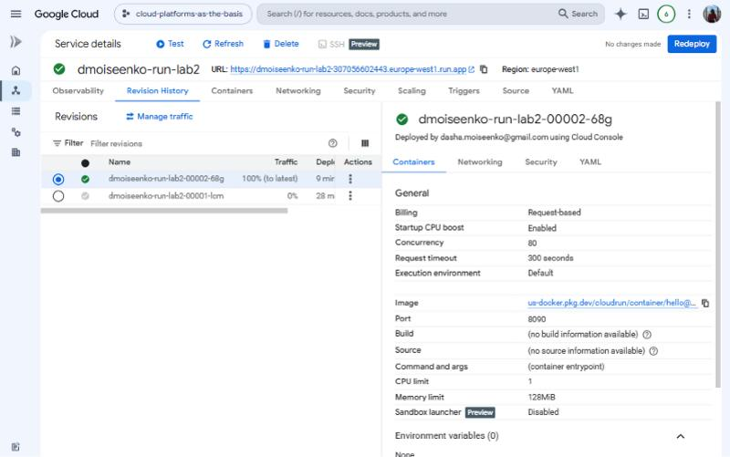

**Попытка 1: разделить трафик 50/50.** В *Manage traffic → Split traffic across multiple revisions* задано 50% на latest (00002) и 50% на 00001.

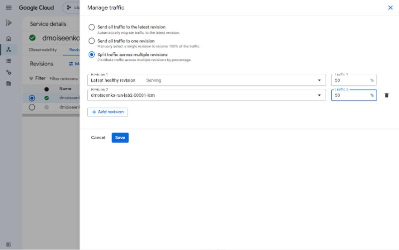

Cloud Run отказал с ошибкой:

> `service level max instances must be greater than or equal to the number of targets receiving traffic`

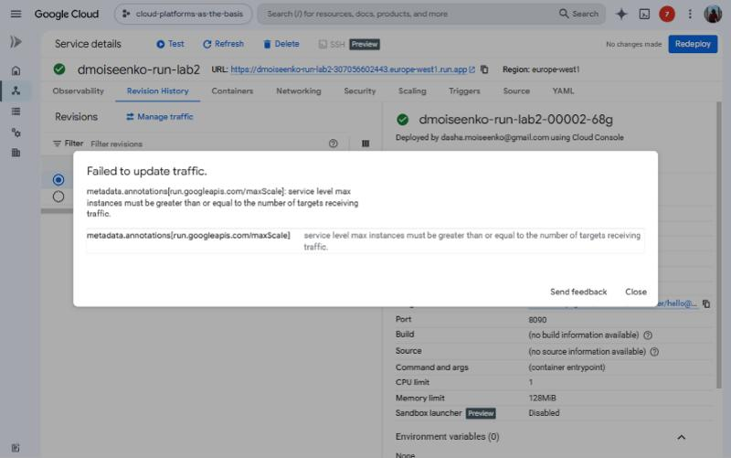

Причина в том, что для сервиса задан максимум **1 инстанс**, а каждой ревизии с трафиком нужен хотя бы один свой инстанс. Во вкладке **Scaling** лимит поднят до **2**, после чего разделение применилось:

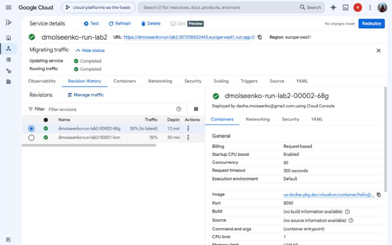

**Проверка распределения.** Из браузера отправлено 20 запросов к сервису, у каждого ответа считано имя ревизии со страницы:

```text
{"dmoiseenko-run-lab2-00001-lcm": 10, "dmoiseenko-run-lab2-00002-68g": 10}
```

Ровно 50/50.

**Попытка 2: весь трафик на одну ревизию (откат).** Через *Send all traffic to one revision* 100% трафика переведено на старую ревизию 00001:

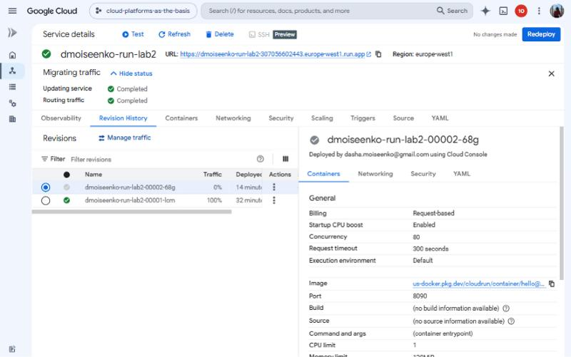

Проверка показала, что 10 из 10 запросов обслужила `00001-lcm`, и страница снова показывает первую ревизию:


### 6. Удаление сервиса

Сервис `dmoiseenko-run-lab2` удалён вместе со всеми ревизиями (*Delete* с подтверждением по имени). Список сервисов пуст:

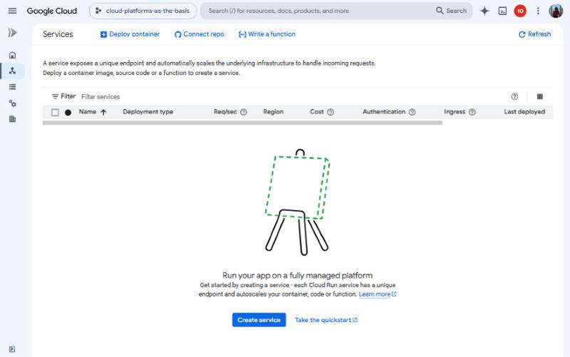

## Выводы

1. **Cloud Run** — serverless-платформа для контейнеров. Не нужно управлять ВМ и балансировщиками: достаточно указать образ, и через минуту сервис доступен по HTTPS-ссылке.
2. **Масштабирование до нуля и оплата за запросы** делают Cloud Run выгодным для MVP и сервисов с неравномерной нагрузкой: пока запросов нет, плата почти не берётся. Расплата за это — холодный старт первого запроса.
3. **Логи и метрики** собираются автоматически и позволяют сразу увидеть задержки, коды ответов, число инстансов и загрузку CPU и памяти. По ним видно, что 128 MiB для простого сервиса достаточно.
4. **Каждое изменение конфигурации создаёт новую неизменяемую ревизию.** Порт приложения должен браться из `$PORT`, иначе после смены порта ревизия не запустится.
5. **Управление трафиком между ревизиями** позволяет делать canary-релизы (часть пользователей на новой версии), A/B-тесты и мгновенный откат без пересборки. Ограничение: max instances сервиса должно быть не меньше числа ревизий, получающих трафик.
