University: [ITMO University](https://itmo.ru/ru/)
Faculty: [FICT](https://fict.itmo.ru)
Course: [Cloud platforms as the basis of technology entrepreneurship](https://github.com/itmo-ict-faculty/cloud-platforms-as-the-basis-of-technology-entrepreneurship)
Year: 2026/2027
Group: U4125
Author: Moiseenko Daria Evgenievna
Lab: Lab3
Date of create: 02.11.2026
Date of finished: —

# Лабораторная работа №3 «Исследование Cloud Storage»

## Цель работы

Познакомиться с понятиями и принципами работы облачного хранилища, моделями хранения данных (блочной, файловой, объектной), а также с основными возможностями Google Cloud Storage.

## Теория: модели хранения данных

| Модель | Как хранятся данные | Пример в GCP | Где применяется |
|---|---|---|---|
| **Блочная** | Диск разбит на блоки фиксированного размера. ОС сама строит на нём файловую систему | Persistent Disk, Hyperdisk | Диски ВМ, базы данных |
| **Файловая** | Иерархия папок и файлов с общим доступом по сети (NFS/SMB) | Filestore | Общие папки для нескольких серверов |
| **Объектная** | Плоское пространство «объектов» (данные + метаданные + ключ-имя) в бакетах, доступ по HTTP(S) | **Cloud Storage** | Картинки, видео, бэкапы, статика сайтов, датасеты |

В объектном хранилище **папок на самом деле нет**. «Папка» `images/` — это лишь общий префикс в именах объектов (`images/img1.png`), и консоль показывает его как каталог.

## Исходные данные

| Параметр | Значение |
|---|---|
| Проект GCP | `cloud-platforms-as-the-basis` (есть права на Cloud Storage) |
| Бакет | `dmoiseenko-lab3-bucket` |
| Расположение | Region `us-east1`, класс хранения Standard |
| Файлы | 4 изображения PNG 640×400 (`img1.png` … `img4.png`) |

## Ход работы

### 1. Создание бакета

**Cloud Storage → Buckets → Create**:

* **Имя**: `dmoiseenko-lab3-bucket`. Имена бакетов глобально уникальны во всём Google Cloud;
* **Location type**: *Region* (`us-east1`). Это дешевле multi-region ($0.020 против $0.026 за ГБ в месяц), и для учебных данных этого достаточно;
* **Storage class**: *Standard*, для данных с частым доступом;
* **Prevent public access**: галочка *Enforce public access prevention* **снята**, иначе на шаге 5 файлы нельзя будет открыть публично;
* **Access control**: *Uniform*, доступ ко всем объектам управляется единой политикой IAM на уровне бакета.

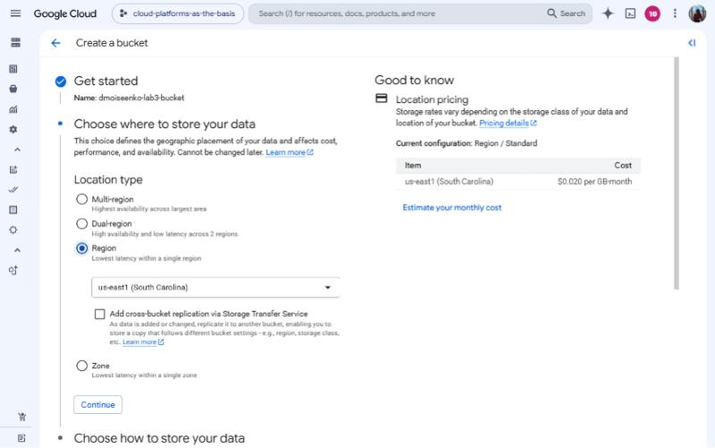
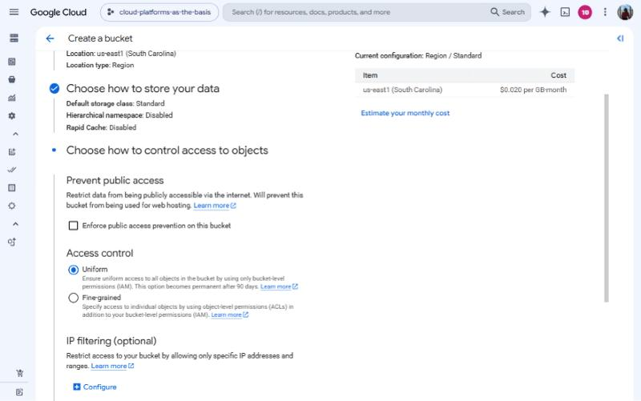
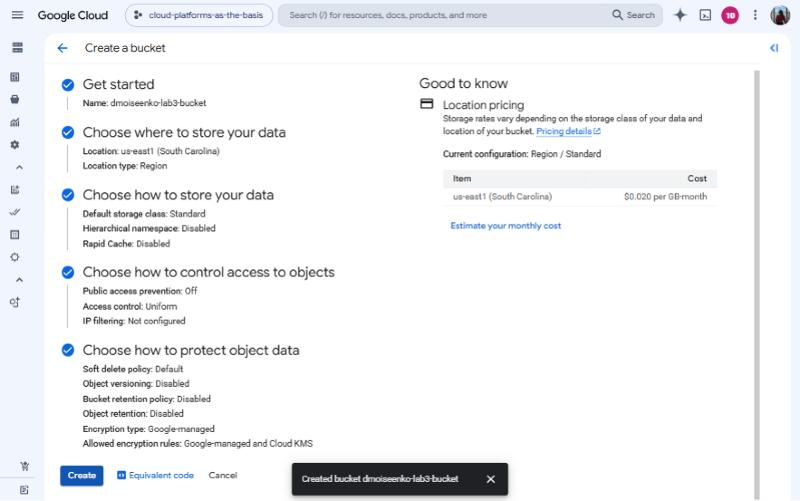

### 2. Загрузка 4 изображений

Через *Upload* в корень бакета загружены 4 файла PNG:

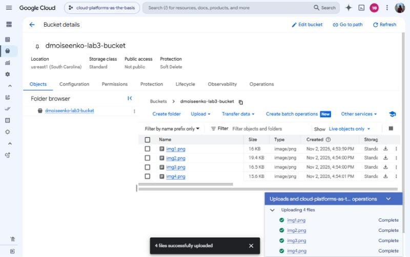

### 3. Создание папки и перемещение файлов

Через *Create folder* создана папка `images/`:

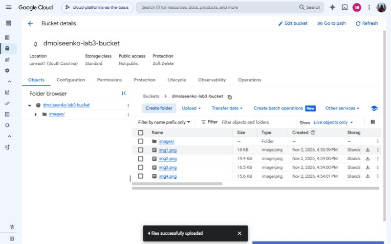

Каждый файл перемещён в неё через меню объекта *⋮ → Move* с назначением `dmoiseenko-lab3-bucket/images/`:

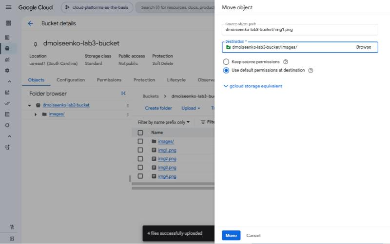

В результате все файлы лежат в `images/`, а корень бакета содержит только папку:

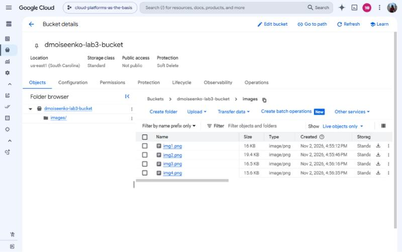

> По сути Move в Cloud Storage — это копирование объекта под новым именем (`images/img1.png`) и удаление старого. У объектов поменялось время создания: это новые объекты.

### 4. Настройка публичного доступа

Во вкладке **Permissions → Grant access** принципалу **`allUsers`** (все пользователи интернета) выдана роль **Storage Object Viewer**, то есть право читать объекты. Консоль предупреждает, что ресурс станет публичным:

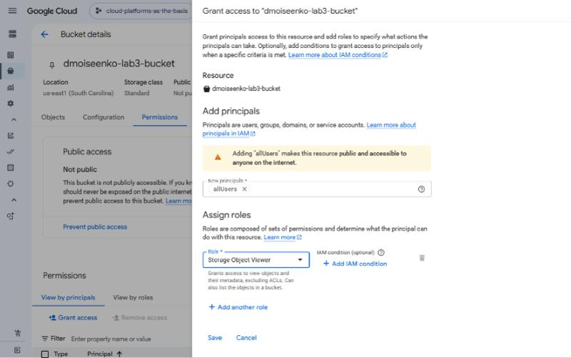

После сохранения статус бакета изменился на **Public access: Access granted to public principals**:

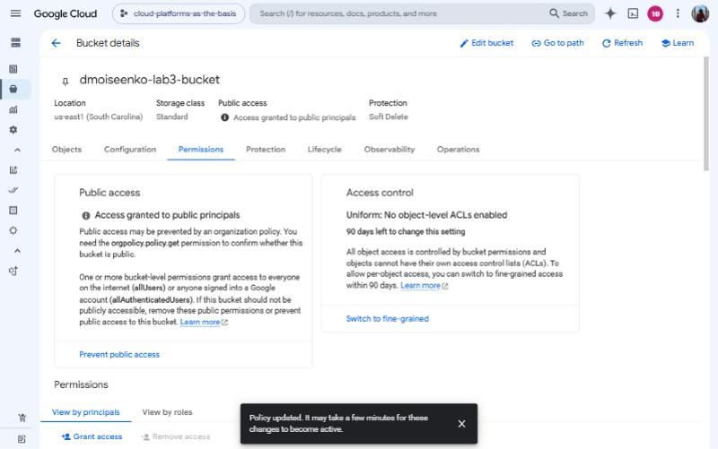

### 5. Создание ссылок на файлы

В контекстном меню файла (*⋮*) есть несколько вариантов ссылки:

* **Copy Public URL**: `https://storage.googleapis.com/<bucket>/<object>`, открывается любым человеком без входа в аккаунт (работает только при публичном доступе);
* **Copy Authenticated URL**: `https://storage.cloud.google.com/...`, требует входа в Google-аккаунт с правами на объект;
* **Copy Cloud Storage URI**: `gs://<bucket>/<object>`, адрес для `gcloud`/SDK.

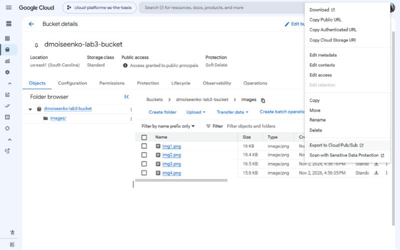
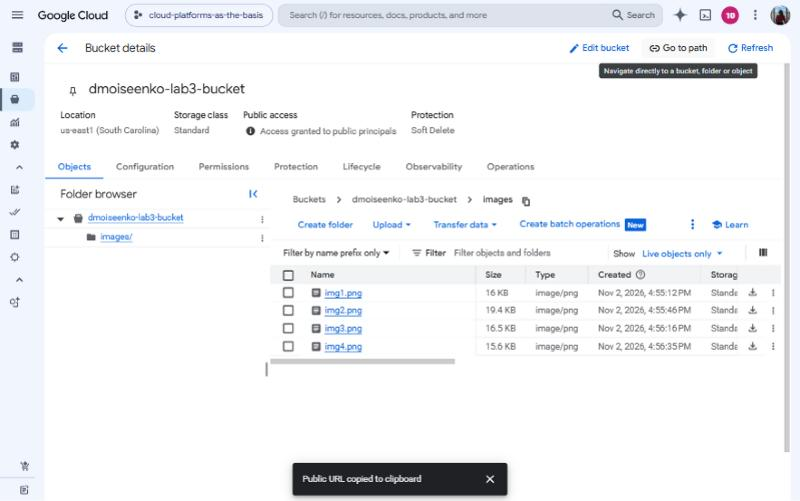

Полученные публичные ссылки:

```text
https://storage.googleapis.com/dmoiseenko-lab3-bucket/images/img1.png
https://storage.googleapis.com/dmoiseenko-lab3-bucket/images/img2.png
https://storage.googleapis.com/dmoiseenko-lab3-bucket/images/img3.png
https://storage.googleapis.com/dmoiseenko-lab3-bucket/images/img4.png
```

Проверка: `img1.png` открывается в браузере по публичной ссылке, остальные три файла отвечают `200 image/png`.

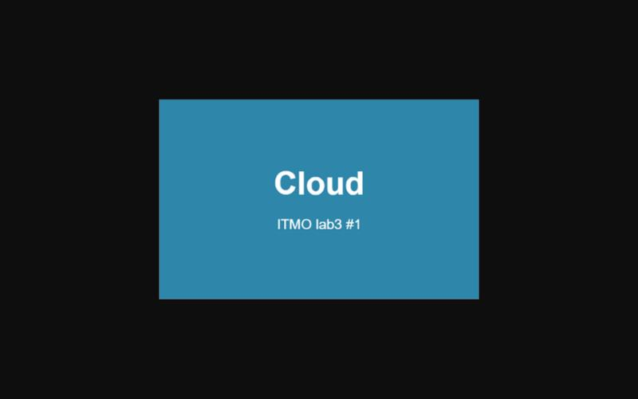

### 6. Удаление ресурсов

Бакет `dmoiseenko-lab3-bucket` удалён вместе со всем содержимым (подтверждение вводом `DELETE`). Учебный бакет `lab1-bucket-itmo` не трогали. Ссылки выше больше не работают.

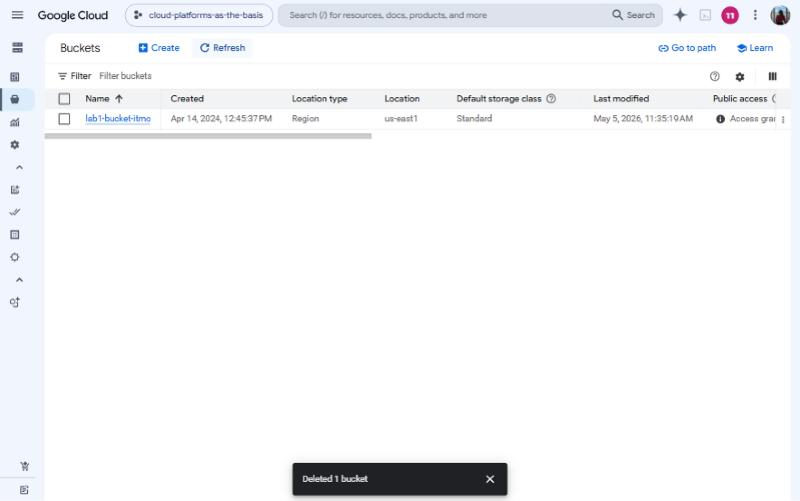

## Выводы

1. **Cloud Storage — объектное хранилище.** Данные лежат в бакетах как объекты с ключом-именем, а «папки» — всего лишь префиксы имён. Хранилище подходит для неструктурированных данных: изображений, видео, бэкапов, статики сайтов.
2. **Расположение и класс хранения влияют на цену и надёжность.** Region дешевле, multi-region надёжнее и ближе к пользователям по всему миру. Классы Nearline/Coldline/Archive дешевле в хранении, но дороже при чтении.
3. **Доступ управляется через IAM.** По умолчанию бакет закрыт и защищён *public access prevention*. Публичным его делает явная выдача роли `allUsers → Storage Object Viewer`. Так можно быстро раздавать файлы, например картинки для сайта, но открывать стоит только то, что действительно должно быть публичным: такая ссылка доступна всему интернету.
4. **Для разных задач есть разные виды ссылок:** публичный URL для всех, аутентифицированный URL для пользователей с правами, `gs://` URI для программного доступа.
5. Связь с лабораторной №1: бакет `lab1-bucket-itmo` настроен точно так же (`allUsers` → Storage Object Viewer). Поэтому файлы из него копировались при любой роли сервисного аккаунта.
