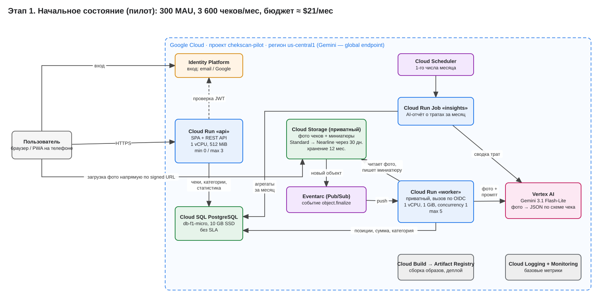
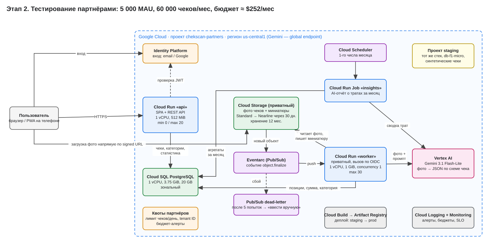
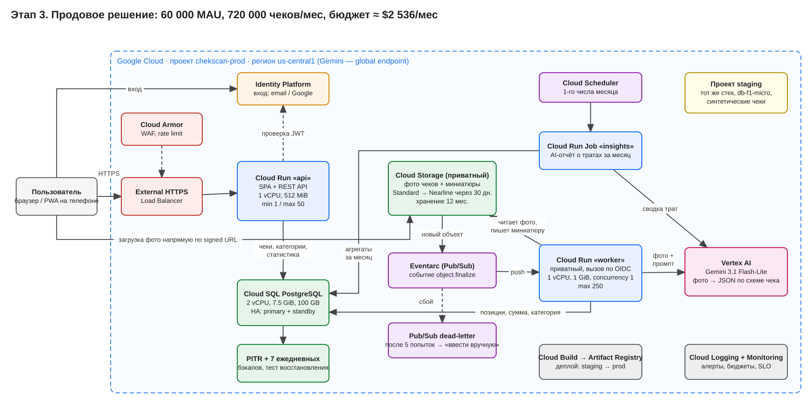

University: [ITMO University](https://itmo.ru/ru/)
Faculty: [FICT](https://fict.itmo.ru)
Course: [Cloud platforms as the basis of technology entrepreneurship](https://github.com/ex-itmo-ict-faculty/cloud-platforms-as-the-basis-of-technology-entrepreneurship)
Year: 2026/2027
Group: U4125
Author: Moiseenko Daria Evgenievna
Lab: Lab4
Date of create: 02.11.2026
Date of finished: —

# Лабораторная работа №4. Схема и экономика облачной инфраструктуры для «ЧекСкан»

## Цель

Спроектировать облачную инфраструктуру приложения в Google Cloud для трёх состояний — начального, тестирования партнёрами и продового, — нарисовать схемы в draw.io, посчитать ежемесячные затраты и обосновать выбор ресурсов. Кейс выбран самостоятельно.

## 1. Кейс: «ЧекСкан» — сканер чеков и учёт расходов

**ЧекСкан** — веб-приложение (PWA, ставится на телефон как приложение) для учёта личных расходов:

1. Пользователь фотографирует бумажный чек.
2. Фото уходит в облако. Мультимодальная модель **Gemini 3.1 Flash-Lite** (Vertex AI) читает чек и возвращает структурированный JSON: магазин, дата, позиции, сумма, категория (продукты, кафе, транспорт и т. д.).
3. Пользователь видит расход в ленте, может поправить категорию.
4. Раз в месяц приложение строит AI-отчёт: на что ушли деньги, что изменилось относительно прошлого месяца, где можно сэкономить.

Почему кейс подходит для работы: в нём есть всё, на чём строится облачная экономика — запросы пользователей, тяжёлая асинхронная обработка, платный AI по токенам, хранилище файлов с жизненным циклом, реляционная база и трафик. Стоимость заметно меняется с ростом нагрузки, и между этапами есть разные решения.

## 2. Допущения

Все допущения собраны в одном месте — в `COMMON` и `STAGES` файла [`cost_model.py`](cost_model.py). Если изменить любое из них, вся модель пересчитается.

| Параметр | Значение | Комментарий |
|---|---:|---|
| Чеков на активного пользователя (MAU) в месяц | 12 | ~3 в неделю, крупные покупки |
| Попыток распознавания на чек | 1,05 | 5% повторов: размытое фото, сбой |
| Токены на картинку | 1 120 | Gemini 3, `media_resolution` HIGH |
| Токены промпта / ответа | 500 / 700 | инструкция + JSON-схема / JSON с позициями |
| Месячный AI-отчёт | 3 000 вход / 600 выход | агрегаты за месяц, не сами фото |
| Время обработки чека в worker | 6 c | ожидание ответа модели + миниатюра + запись в БД |
| Worker | 1 vCPU, 1 GiB, concurrency 1 | один чек — один экземпляр, предсказуемая память |
| API | 1 vCPU, 512 MiB, 0,15 c на вызов | REST + раздача SPA |
| Визитов на MAU в месяц | 12 | по 6 API-вызовов + 4 статических файла (1,5 MiB) |
| Фото / миниатюра | 450 KiB / 40 KiB | фото сжимается в браузере до ~1600 px |
| Хранение фото | 12 месяцев | 1-й месяц Standard, далее Nearline |
| Строка чека в БД | ~5 KiB | позиции + индексы |
| Месяц | 720 ч | как в калькуляторе Google |
| Резерв | 20% | на рост, ошибки допущений, налоги/курс |

Три этапа:

| Этап | MAU | Чеков/мес | Пик, чеков/с | Кто пользуется |
|---|---:|---:|---:|---|
| 1. Начальное (пилот) | 300 | 3 600 | 0,2 | команда, друзья, первые пользователи |
| 2. Тестирование партнёрами | 5 000 | 60 000 | 3 | 2–3 партнёра (банк-кешбэк, бухгалтерский сервис) дают доступ своим клиентам |
| 3. Продовое решение | 60 000 | 720 000 | 30 | открытый запуск |

Пик — это вечер после работы и выходные, когда люди разбирают чеки пачкой.

## 3. Архитектура и поток данных

Регион — `us-central1` (Айова): здесь самые низкие цены на Cloud Run, Cloud SQL и Storage, а Gemini вызывается через global endpoint.

**Путь чека:**

1. Браузер входит через **Identity Platform** и получает JWT.
2. **Cloud Run «api»** проверяет JWT и выдаёт **V4 signed URL** — одноразовую ссылку на загрузку на 10 минут.
3. Браузер загружает фото **напрямую в приватный бакет Cloud Storage**, минуя API. Сервер не тратит время и трафик на мегабайты фото.
4. Создание объекта порождает событие `object.finalize`. **Eventarc** (транспорт — Pub/Sub) доставляет его в приватный **Cloud Run «worker»**, вызов идёт с OIDC-токеном.
5. Worker читает фото, вызывает **Gemini 3.1 Flash-Lite** с JSON-схемой ответа, пишет позиции в **Cloud SQL PostgreSQL** и кладёт миниатюру обратно в бакет.
6. Если чек не распознан за 5 попыток, событие уходит в **dead-letter-топик**, и пользователь видит «введите вручную».
7. Раз в месяц **Cloud Scheduler** запускает **Cloud Run Job «insights»**: он берёт агрегаты из SQL, отправляет их в Gemini и сохраняет отчёт.

**Сопровождение:**
- CI/CD — **Cloud Build → Artifact Registry**.
- Наблюдаемость — **Cloud Logging / Monitoring**, алерты и бюджеты.

## 4. Схемы трёх состояний

Исходник — [`diagrams/chekscan-infrastructure.drawio`](diagrams/chekscan-infrastructure.drawio): один файл, три страницы («1. Пилот», «2. Партнёры», «3. Прод»). Открывается на [app.diagrams.net](https://app.diagrams.net): *File → Open from → Device*. Ниже — те же схемы в SVG/PNG. Схемы генерирует [`diagrams/make_diagrams.py`](diagrams/make_diagrams.py), поэтому .drawio и картинки всегда совпадают.

### 4.1. Начальное состояние (пилот) — ≈ $21/мес



- Минимальный, но **полностью рабочий** контур. Все сервисы масштабируются до нуля, кроме базы.
- Cloud SQL — самый маленький `db-f1-micro` (без SLA, для пилота допустимо).
- Нет балансировщика, WAF и staging: API открыт через встроенный HTTPS-адрес Cloud Run.
- Ограничения сверху (`max 3` для API, `max 5` для worker) защищают от случайного счёта.

### 4.2. Тестирование партнёрами — ≈ $252/мес



Что добавилось и почему:

- **Cloud SQL 1 vCPU / 3,75 GiB** — у f1-micro разделяемое ядро и всего 614 MB RAM. При 3 чеках/с в пике и аналитических запросах это узкое место.
- **Проект staging** — партнёрам нельзя ломать прод. Каждое изменение промпта и схемы сначала проверяется на наборе синтетических чеков.
- **Dead-letter-очередь** — при 60 тыс. чеков 5% сбойных — это 3 000 событий в месяц. Их нельзя терять молча.
- **Квоты партнёров**: tenant ID, дневной лимит чеков, бюджет-алерты — чтобы один партнёр не «съел» бюджет AI.
- Лимиты подняты: API до 20, worker до 30 экземпляров.

### 4.3. Продовое решение — ≈ $2 536/мес



- **External HTTPS Load Balancer + Cloud Armor** (WAF, rate limit по IP и пользователю) — защита публичного сервиса от ботов и перебора.
- **Cloud SQL HA** (primary + standby в другой зоне), 2 vCPU / 7,5 GiB, PITR и 7 ежедневных бэкапов — потеря данных о финансах для продукта критична.
- **API `min 1`** — один тёплый экземпляр убирает холодный старт (~1–2 c) у первого пользователя после паузы. Стоит < $10/мес.
- **Identity Platform** — после 50 тыс. MAU вход становится платным (+$55/мес).
- Lifecycle: фото через 30 дней переезжает в Nearline (вдвое дешевле хранение).

## 5. Проверка пиковой нагрузки

Сколько экземпляров worker нужно в пике: `пик чеков/с × 1,05 попытки × 6 c` (concurrency 1).

| Этап | Пик, чеков/с | Нужно worker | Лимит `max` | Запас | Вход в Gemini в пик, токенов/мин |
|---|---:|---:|---:|---:|---:|
| Пилот | 0,2 | 2 | 5 | ×2,5 | 20 412 |
| Партнёры | 3 | 19 | 30 | ×1,6 | 306 180 |
| Прод | 30 | 189 | 250 | ×1,3 | 3 061 800 |

- **Cloud Run.** Лимит по умолчанию — 100 экземпляров на сервис в регионе; для прода нужно заранее запросить повышение квоты до 250+.
- **Gemini.** Для оплаты по факту в Vertex AI действует общая динамическая квота. При ~3 млн токенов/мин в пике возможны ответы 429, поэтому:
  - у worker настроен повтор с экспоненциальной задержкой (Eventarc/Pub/Sub сам повторяет доставку);
  - при устойчивом росте стоит рассмотреть Provisioned Throughput — это фиксированная плата за гарантированную пропускную способность.
- **Cloud SQL.** Запись в базу — одна транзакция на чек (~30 в секунду в пике), для 2 vCPU это немного. Соединения ограничены пулом: 250 worker × 1 соединение укладываются в `max_connections` инстанса 7,5 GiB. На случай роста предусмотрен Cloud SQL connector + pgbouncer.

## 6. Обоснование выбора ресурсов

| Задача | Выбрано | Альтернатива | Почему не она |
|---|---|---|---|
| Распознавание чеков | **Gemini 3.1 Flash-Lite** | Document AI Expense Parser; Gemini Pro | Expense Parser стоит порядка цента за страницу — в разы дороже Flash-Lite, и категорию трат он не ставит. Pro точнее на сложных случаях, но дороже в разы; для типовых чеков Flash-Lite хватает. Сложные чеки можно отправлять в Pro точечно |
| API | **Cloud Run** (request-based) | GKE; Compute Engine VM | Платим только за время запросов, масштабирование до нуля на пилоте. GKE — минимум ~$73/мес за управление кластером плюс узлы и администрирование |
| Обработка | **Отдельный Cloud Run worker + Eventarc** | Распознавать прямо в API | Распознавание занимает секунды. Отдельный сервис масштабируется независимо, не держит пользовательские запросы и даёт повторы и DLQ «из коробки» |
| База | **Cloud SQL PostgreSQL** с первого дня | Firestore (дешевле на пилоте); AlloyDB | См. раздел 6.1. AlloyDB — для нагрузок много больше нашей, минимум в разы дороже |
| Файлы | **Cloud Storage**, Standard → Nearline | Хранить фото в БД | Фото в БД раздувают дорогой SSD и бэкапы. В GCS гигабайт стоит $0,02 → $0,01, а signed URL снимает нагрузку с API |
| Вход | **Identity Platform** | Своя авторизация | Бесплатно до 50 тыс. MAU, без хранения паролей у себя — меньше рисков |
| Периметр (прод) | **HTTPS LB + Cloud Armor** | Только адрес Cloud Run | ~$43/мес за WAF, rate limit и свой домен с управляемым сертификатом. Для финансового приложения оправдано |
| Регион | **us-central1** | europe-west | Tier 1 — самые низкие цены. Для реального запуска с пользователями в РФ/ЕС пришлось бы учитывать требования к локализации персональных данных (152-ФЗ / GDPR) — это отдельное решение |

### 6.1. «Самое дешёвое не всегда оптимально»

1. **Cloud SQL вместо Firestore на пилоте.**
   - На пилоте Firestore обошёлся бы почти в $0: бесплатная квота, а инстанс SQL стоит ~$7,6/мес, то есть ~40% всего счёта пилота.
   - Но главная функция продукта — аналитика: суммы по категориям и месяцам, сравнение периодов, поиск по позициям. Это `GROUP BY` и `JOIN`, а в документной базе такие отчёты пришлось бы собирать в коде или вести счётчики вручную.
   - Переезд с Firestore на SQL на этапе партнёров — это миграция данных живых пользователей. Это дороже, чем $7,6 × несколько месяцев.
2. **HA-база в проде** стоит вдвое дороже зональной (+$97/мес), но без неё сбой одной зоны означает часы простоя и риск потерять последние записи о расходах.
3. **Тёплый экземпляр API** (+$9,7/мес) — без него первый пользователь после паузы ждёт 1–2 секунды. Это заметно в мобильном сценарии «сфотографировал и пошёл».
4. **Staging** (+$23 / +$169 в месяц) — смена промпта или модели может тихо испортить распознавание. Дешевле проверить на синтетических чеках, чем разбираться с жалобами партнёров.
5. **Высокое разрешение картинки (HIGH)** — с MEDIUM прод дешевле на 5,5%. Но мелкий шрифт чеков на MEDIUM читается хуже: каждая ошибка — повторная попытка или ручной ввод. Экономия теряется в повторах и в доверии пользователей.

И обратная сторона: где переплачивать **не** стали.
- Нет GKE и AlloyDB.
- Нет Provisioned Throughput на пилоте.
- Нет Premium-поддержки.
- Логи не хранятся сверх стандартных 30 дней.

## 7. Тарифы

Цены — с официальных страниц Google Cloud на 02.11.2026, регион us-central1, USD без налогов. Бесплатные квоты (Free Tier) **не вычитались** — это консервативная оценка.

| Сервис | Тариф | Источник |
|---|---|---|
| Gemini 3.1 Flash-Lite | вход $0,25 / 1 млн токенов, выход $1,50 / 1 млн | [Vertex AI pricing](https://cloud.google.com/vertex-ai/generative-ai/pricing) |
| Токены изображения (Gemini 3) | LOW 280, MEDIUM 560, HIGH 1 120, ULTRA_HIGH 2 240 | [Image understanding](https://docs.cloud.google.com/gemini-enterprise-agent-platform/models/capabilities/image-understanding), [media resolution](https://ai.google.dev/gemini-api/docs/media-resolution) |
| Cloud Run | CPU $0,000024 / vCPU·с, память $0,0000025 / GiB·с, $0,40 / 1 млн запросов; простой min-instance — $0,0000025 / vCPU·с | [Cloud Run pricing](https://cloud.google.com/run/pricing) |
| Cloud SQL PostgreSQL | db-f1-micro $0,0105/ч; vCPU $0,0413/ч (HA $0,0826); память $0,007 / GiB·ч (HA $0,014); SSD $0,17 / GiB·мес (HA $0,34); бэкап $0,08 / GiB·мес | [Cloud SQL pricing](https://cloud.google.com/sql/pricing) |
| Cloud Storage | Standard $0,020 / GiB·мес, Nearline $0,010; класс A $0,005 / 1 тыс. (Nearline $0,01); класс B $0,0004 / 1 тыс. (Nearline $0,001); извлечение Nearline $0,01 / GiB | [Storage pricing](https://cloud.google.com/storage/pricing) |
| Исходящий трафик | $0,12 / GiB (Premium tier, до 1 TiB) | [Network pricing](https://cloud.google.com/vpc/network-pricing) |
| Load Balancer | $0,025/ч за правило + $0,008 / GiB | [LB pricing](https://cloud.google.com/load-balancing/pricing) |
| Cloud Armor Standard | $5 / политика·мес, $1 / правило·мес, $0,75 / 1 млн запросов | [Armor pricing](https://cloud.google.com/armor/pricing) |
| Eventarc / Pub/Sub | Eventarc Standard (источник Cloud Storage) $0; Pub/Sub $40 / TiB | [Eventarc pricing](https://cloud.google.com/eventarc/pricing) |
| Identity Platform | до 50 тыс. MAU бесплатно, далее $0,0055 / MAU | [Identity Platform pricing](https://cloud.google.com/identity-platform/pricing) |
| Cloud Logging | $0,50 / GiB | [Observability pricing](https://cloud.google.com/products/observability/pricing) |
| Cloud Scheduler | $0,10 / задание·мес | [Scheduler pricing](https://cloud.google.com/scheduler/pricing) |
| Artifact Registry / Cloud Build | $0,10 / GiB·мес / $0,006 / мин сборки | [AR pricing](https://cloud.google.com/artifact-registry/pricing), [Build pricing](https://cloud.google.com/build/pricing) |

## 8. Экономическая модель

### 8.1. Формулы

Обозначения: `U` — MAU, `N = 12·U` — чеков в месяц, `M = 1,05·N` — попыток распознавания.

- **AI, распознавание:** `M × ((1120 + 500) × $0,25 + 700 × $1,50) / 10⁶`. На одну попытку это ≈ **$0,00146**, причём 2/3 цены — выходные токены JSON.
- **AI, отчёты:** `U × (3000 × $0,25 + 600 × $1,50) / 10⁶`.
- **Worker:** `M × 6 c × (1 vCPU × CPU + 1 GiB × память) + M × цена запроса`.
- **API:** `(вызовы × 0,15 c + статика × 0,01 c) × (CPU + 0,5 GiB × память) + запросы × $0,40/млн`.
- **Тёплый экземпляр:** `min × 2 592 000 c × тариф простоя`.
- **Cloud SQL:** `инстанс × 720 ч + диск × тариф SSD + 1,5 × объём данных × тариф бэкапа`.
- **Storage:** фото месяца в Standard + 11 месяцев в Nearline (установившийся режим через год) + операции A/B + 3% чтений из Nearline.
- **Трафик:** `визиты × 1,5 MiB SPA + ответы API + миниатюры + 20% просмотров полного фото`.
- **LB:** правило × 720 ч + трафик только SPA/API (фото идут из GCS по signed URL мимо LB).
- **Staging:** 10% переменных затрат прода + отдельный db-f1-micro.
- **Резерв** — 20% от суммы.

### 8.2. Затраты в месяц, USD

Результат [`cost_model.py`](cost_model.py) (сохраняется и в [`cost_results.json`](cost_results.json)):

| Статья, USD/месяц | Начальное (пилот) | Тестирование партнёрами | Продовое решение |
|---|---:|---:|---:|
| Vertex AI: распознавание чеков | 5.50 | 91.67 | 1099.98 |
| Vertex AI: ежемесячные отчёты | 0.49 | 8.25 | 99.00 |
| Cloud Run API: запросы и время | 0.15 | 2.42 | 29.01 |
| Cloud Run API: 1 тёплый экземпляр | 0.00 | 0.00 | 9.72 |
| Cloud Run Worker | 0.60 | 10.04 | 120.51 |
| Cloud Run Job отчётов | 0.02 | 0.25 | 3.03 |
| Eventarc / Pub/Sub | 0.0003 | 0.0046 | 0.06 |
| Cloud Storage: фото, операции | 0.35 | 5.78 | 69.33 |
| Cloud SQL: инстанс | 7.56 | 48.64 | 194.54 |
| Cloud SQL: диск и бэкапы | 1.70 | 3.76 | 38.41 |
| Интернет-трафик | 0.85 | 14.16 | 169.90 |
| Load Balancer | 0.00 | 0.00 | 26.64 |
| Cloud Armor | 0.00 | 0.00 | 16.88 |
| Identity Platform | 0.00 | 0.00 | 55.00 |
| Cloud Logging | 0.03 | 0.46 | 5.54 |
| Cloud Scheduler | 0.10 | 0.20 | 0.20 |
| Artifact Registry | 0.10 | 0.20 | 0.49 |
| Cloud Build | 0.36 | 1.80 | 6.00 |
| Окружение staging | 0.00 | 22.54 | 168.87 |
| **Всего облако** | **17.80** | **210.16** | **2113.12** |
| **Резерв 20%** | **3.56** | **42.03** | **422.62** |
| **Бюджет с резервом** | **21.36** | **252.20** | **2535.75** |

### 8.3. Удельные показатели

| Этап | USD за чек (без резерва) | Доля AI | Фото в хранилище | Данные в БД | Исходящий трафик |
|---|---:|---:|---:|---:|---:|
| Пилот | 0,0059 | 34% | 20 GiB | 0,2 GiB | 7 GiB |
| Партнёры | 0,0042 | 48% | 337 GiB | 3,4 GiB | 118 GiB |
| Прод | 0,0035 | 57% | 4 038 GiB | 41 GiB | 1 416 GiB |

Выводы из таблиц:

- **На пилоте счёт определяют фиксированные затраты.** Почти половина — база данных ($9,3 из $17,8), AI — лишь треть.
- **С ростом главной статьёй становится AI** (57% в проде), а цена одного чека падает с 0,6 до 0,35 цента, потому что фиксированные затраты размазываются.
- **Юнит-экономика.** В проде облако обходится в **≈ $0,035 на активного пользователя в месяц** ($2 113 / 60 000) или ≈ $0,042 с резервом. Подписка даже за $1/мес или партнёрская выплата в несколько центов за пользователя покрывает инфраструктуру с большим запасом.

### 8.4. Чувствительность (прод, бюджет с резервом)

| Изменение допущения | Бюджет, USD/мес | Изменение |
|---|---:|---:|
| Базовый сценарий | 2 535.75 | 0% |
| Картинка ULTRA_HIGH (2 240 токенов) вместо HIGH | 2 815.16 | +11,0% |
| Картинка MEDIUM (560 токенов) вместо HIGH | 2 396.04 | −5,5% |
| Ответ модели 1 400 токенов вместо 700 | 3 583.56 | +41,3% |
| 25 чеков на пользователя вместо 12 | 4 412.64 | +74,0% |
| 1,30 попытки на чек вместо 1,05 | 2 919.78 | +15,1% |

Что из этого следует:

- **Самый сильный рычаг — длина ответа модели**, а не размер картинки: выходной токен в 6 раз дороже входного. Поэтому в промпте задаётся компактная JSON-схема (короткие ключи, без пояснений), а `max_output_tokens` ограничен.
- **Второй рычаг — активность пользователей.** Если продукт «зайдёт» и люди начнут сканировать всё подряд, счёт растёт почти линейно. Ставим бюджет-алерты на 50/90/100% и дневной лимит чеков на пользователя на бесплатном тарифе.
- **Качество распознавания — это тоже деньги:** каждые +25% повторов дают +15% к бюджету.

## 9. Надёжность и безопасность

- **Данные о покупках — персональные.** Бакет приватный, Uniform bucket-level access, публичный доступ запрещён политикой (Public access prevention). Фото выдаются только по signed URL на несколько минут.
- **Минимальные права.** У api, worker и job свои сервисные аккаунты:
  - api может только подписывать URL и писать в свою схему БД;
  - worker — читать/писать объекты и вызывать Vertex AI;
  - никто не имеет роли Owner/Editor.
- **Worker не публичный**: вызов только от Eventarc с OIDC-токеном (`roles/run.invoker` у сервисного аккаунта триггера).
- **Идемпотентность:** ключ чека — `bucket/object#generation`. Повторная доставка события не создаёт дубль расхода.
- **Повторы и DLQ:** 5 попыток с экспоненциальной задержкой, затем dead-letter и статус «введите вручную».
- **Секреты** (пароль БД) — в Secret Manager, подключение к Cloud SQL — через коннектор по IAM.
- **Резервные копии:** в проде PITR + 7 ежедневных бэкапов, раз в квартал — пробное восстановление в staging.
- **Контроль затрат:**
  - Cloud Billing budgets с алертами;
  - `max instances` на каждом сервисе;
  - квоты партнёров;
  - метрика «стоимость AI на чек» в Monitoring.

## 10. Как воспроизвести расчёт

```bash
python3 lab4/cost_model.py               # печатает таблицы и пишет lab4/cost_results.json
python3 lab4/diagrams/make_diagrams.py   # пересобирает .drawio и SVG
```

Нужен только Python 3, внешних библиотек нет. Чтобы проверить другой сценарий, измените значения в `COMMON` / `STAGES` или цены в `P` и запустите снова.

## Структура папки

```
lab4/
├── lab4_report.md          # этот отчёт
├── cost_model.py           # экономическая модель
├── cost_results.json       # результаты модели
├── diagrams/
│   ├── chekscan-infrastructure.drawio   # схема draw.io, 3 страницы
│   ├── 01-pilot.svg / 02-partners.svg / 03-production.svg
│   └── make_diagrams.py    # генератор схем
└── img/                    # PNG-версии схем
```

## Вывод

Для приложения «ЧекСкан» спроектирована serverless-инфраструктура в Google Cloud, которая растёт вместе с продуктом:

| Этап | Нагрузка | Бюджет с резервом 20% |
|---|---|---:|
| Пилот | 300 пользователей | **≈ $21/мес** |
| Тестирование партнёрами | 5 000 пользователей | **≈ $252/мес** |
| Прод | 60 000 пользователей | **≈ $2 536/мес** |

Архитектура от этапа к этапу не переписывается — меняются размеры и добавляются слои надёжности и защиты:
- staging и DLQ — для партнёров;
- HA-база, балансировщик и WAF — для прода.

Расчёт показал, что на старте главная статья — фиксированные затраты (база), а при росте — AI. Поэтому основная оптимизация — в промпте и длине ответа модели, а не в выборе самой дешёвой инфраструктуры.

Несколько решений сознательно дороже минимально возможных: Cloud SQL с первого дня, HA, тёплый экземпляр, staging, высокое разрешение картинок. Каждое из них снижает риски — миграции, простоя, ошибок распознавания — сильнее, чем стоит.
